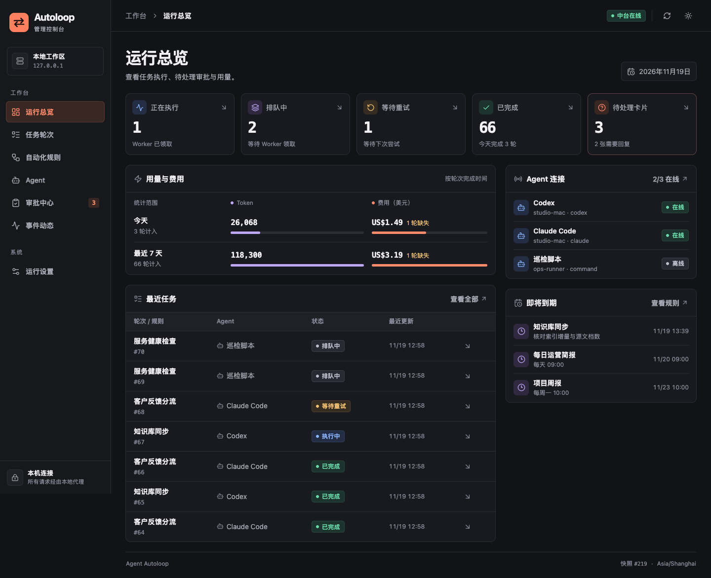

# Agent Autoloop Console

同一个仓库包含 Agent Autoloop 中台和它的本地 Web 控制台。在浏览器里查看任务、控制规则、回复卡片并跟踪中台事件。

- [`agent-autoloop/`](agent-autoloop/) 包含完整的 Agent Autoloop 源码、CLI、插件和测试，保留 [上游 MIT 许可](agent-autoloop/LICENSE)。源码对应已验证的 [上游提交 `ca5c0ff`](https://github.com/KKKKhazix/agent-autoloop/commit/ca5c0ffe2c92be17502c4f1a75cdb71823eeafef)。
- [`src/`](src/) 和 [`server/`](server/) 是 Web 控制台前端和本地 API 代理。



## 启动

需要 Node.js 24 或更新版本、npm，以及一个已安装并登录的命令行 Agent。只需克隆本仓库。已经配置过 Agent Autoloop 时，控制台会读取当前账号的中台配置。

### macOS 双击启动

在 Finder 双击项目根目录的 [启动控制台.command](启动控制台.command)。新电脑首次启动时，按提示选择 Agent 和中台端口。配置由仓库内的 CLI 生成。已有配置会直接使用。脚本会启动尚未运行的中台和 Web 控制台，等两者就绪后打开默认浏览器。第一次启动控制台会安装依赖并构建页面。已运行的服务直接复用，关闭启动终端后服务仍在后台运行。

浏览器打开本机地址后直接进入控制台。启动日志位于 `~/Library/Logs/Agent Autoloop Console`。

如果 Finder 提示没有执行权限，在项目目录运行 `chmod +x ./启动控制台.command ./关闭控制台.command`。启动器使用固定端口，默认 `4175`。如果端口被其他程序占用，可以用 `AUTOLOOP_CONSOLE_PORT` 指定另一个端口。

### macOS 双击关闭

在 Finder 双击 [关闭控制台.command](关闭控制台.command)，即可关闭由本启动器启动的 Web 控制台和中台。配置、密钥与运行记录保留。启动时复用的外部服务仍由原方式管理。若使用自定义数据目录或控制台端口，关闭时沿用启动时的设置。

中台按上游停机方式退出。已经派出的 Agent 进程可能继续执行，重启中台后会接续处理。

### 命令行启动

首次使用时，在仓库根目录运行 `npm run hub -- init --no-service`。初始化会在当前用户的数据目录生成配置和本人密钥。其他配置选项见 [上游安装说明](agent-autoloop/INSTALL.md)。

如果中台尚未运行，在仓库根目录的一个终端运行：

```sh
npm run hub -- up
```

在同一目录的另一个终端启动 Web 控制台：

```sh
npm ci
npm run build
npm start
```

打开终端显示的本机地址，默认是 [http://127.0.0.1:4175](http://127.0.0.1:4175)。在「运行设置」可以查看中台状态。按 Ctrl+C 退出当前终端启动的控制台。

| 系统 | 默认读取的中台配置 |
| --- | --- |
| Windows | `%USERPROFILE%\.agent-autoloop\config.json` |
| macOS、Linux | `~/.agent-autoloop/config.json` |

维护仓库内的中台和控制台时，用 `git pull` 更新两者。`npm run dev` 用同一个本地代理启动开发模式，Vite 自动重建前端，改动后刷新网页即可。

### 自定义本机配置

- `AGENT_AUTOLOOP_HOME` 指向中台配置目录。
- `AUTOLOOP_CONSOLE_PORT` 指定控制台监听端口，默认 `4175`。
- `AUTOLOOP_HUB_URL` 显式指定中台的回环地址，例如 `http://127.0.0.1:3350`。默认使用本机配置的 `url`，如果它是公网地址，会尝试使用配置里的 `hub.listen` 回环入口。

macOS 或 Linux 示例：

```sh
AGENT_AUTOLOOP_HOME="/path/to/hub" AUTOLOOP_CONSOLE_PORT=4180 npm start
```

Windows PowerShell 示例：

```powershell
$env:AGENT_AUTOLOOP_HOME = "C:\path\to\hub"
$env:AUTOLOOP_CONSOLE_PORT = "4180"
npm start
```

## AI Router v0.3

在「运行总览」输入消息。无需工具的问题由 Router 直接回答。需要读取项目、改代码或运行测试时，Router 把任务交给中台。复杂任务会标记为「建议先规划」，规划和执行都由配置的 Agent 完成。

### 配置

1. 把 [.env.example](.env.example) 复制为 `.env.local`，填入实际模型服务。默认关闭 Router。服务端从项目根目录读取此文件，Finder 双击启动同样生效。显式传入的同名环境变量优先。

```dotenv
AUTOLOOP_ROUTER_ENABLED=true
AUTOLOOP_ROUTER_BASE_URL=https://你的模型服务/v1
AUTOLOOP_ROUTER_API_KEY=你的服务端密钥
AUTOLOOP_ROUTER_MODEL=你的模型名称
```

2. 合并 [ai-router 规则示例](docs/ai-router.rule.json) 到本机 `rules.json` 的 `rules` 数组。用 `config.json` 的 `source.name` 替换示例的来源，并确认它在 `rules.json` 的 `sources` 中登记。把 `to` 指向现有 Agent，把 `cwd` 改成现有且已授权的工作目录。保留 `parallel: 1` 让每个请求使用独立事项。其他规则须避开 `router.task.direct` 和 `router.task.plan`。默认配置目录为 `~/.agent-autoloop`，可以用 `AGENT_AUTOLOOP_HOME` 指定目录，用 `AGENT_AUTOLOOP_RULES` 单独指定规则文件。中台和控制台使用同一份规则。
3. 执行 `npm run hub -- check` 校验本机规则。运行中的中台会自动加载有效的规则修改。Router 派发需要本项目附带的中台版本，首次升级时请在轮次执行完毕后重启中台和控制台。macOS 可关闭旧实例后双击启动。如果旧实例由其他方式启动，先用对应方式退出，再从本项目启动。

### 在网页管理项目

在「运行总览 → AI Router」点击「添加项目」，填写名称，再选择已有工程目录和已注册的 Agent。macOS 桌面上可点「浏览文件夹」打开系统选择窗口。也可以直接输入绝对路径，其他环境同样可以手动输入。保存后中台会热加载规则。控制台确认生效版本后刷新列表并选中新项目。本地路径须能在接单机器上使用。项目管理可以在没有模型密钥的情况下使用。

从下拉框选中通过网页添加的项目后，点击「移除项目」。有未完成任务、待回答审批或待复查事项时，界面会说明原因。移除只取消在 AI Router 中的登记，工程、规则和历史仍可用。规则继续供已有任务、审批续办和外部来源使用。默认项目和手写规则由原配置管理。

网页名称和移除状态保存在规则文件旁的 `rules.json.router-projects.json`。规则依旧决定执行目录、Agent 和权限。网页写入经同目录临时文件同步和原子替换，并在替换前核对磁盘版本。网页操作之间共用文件锁。保存后如果中台加载确认超时，控制台会给出提示，磁盘上的完整配置可供核对。

### 手动配置规则

保留现有 `ai-router` 作为默认项目。也可以在同一个 `rules.json` 的 `rules` 数组中手动添加下面的规则。将 `source` 和 `to` 换为本机已登记的来源和 Agent，`cwd` 填写实际工作目录。项目 ID 使用 1 到 42 个小写字母、数字或分隔用的连字符。`default` 留给 `ai-router`。

```json
{
  "name": "ai-project-game-box",
  "when": {
    "source": "local",
    "types": ["router.project.game-box.direct", "router.project.game-box.plan"]
  },
  "to": "codex",
  "cwd": "/你的实际项目路径/game-box",
  "parallel": 1,
  "resume": false,
  "prompt": "读取本轮 context.json 的 events，将 detail 作为用户任务。direct 类型直接执行并验证，plan 类型先检查工程并制定计划，再执行与验证。遵循本规则的目录、权限和审批机制。"
}
```

运行 `npm run hub -- check`，等待中台加载规则后刷新「运行总览」。项目名称取自目录名，任何同来源规则都不能重复匹配该项目的两类事件。若要更换默认项目，等原轮次结束后，修改 `ai-router` 的 `cwd`、Agent 和项目提示词，保留规则名及 `router.task.direct`、`router.task.plan` 的匹配。项目目录须能从控制台所在机器访问，接单机器也须能使用规则配置的同一个路径。

### 使用与验证

在「运行总览 → AI Router」选择目标项目。默认「AI 自动判断」由模型决定直接回答或派发，并判断执行前是否要规划。「直接创建任务」直接提交文字，可勾选「先规划再执行」，无需启用 Router 模型或填写模型密钥。

验收时可在两个独立测试目录注册规则，分别提交创建不同测试文件的任务。点击提交结果的轮次链接，核对关联规则和事件类型。完成后分别检查各目录中的文件。

### Codex 模型档位

「Agent」页显示已加载的模型、思考强度、配置来源和 Worker。未显式设置的 Codex 字段显示「继承 Codex CLI 默认」。控制台不读取 Worker 的 Codex 用户配置。Router 分类模型来自 `AUTOLOOP_ROUTER_MODEL`，它单独显示在 AI Router 面板。

1. 在「运行总览 → AI Router」选择使用 Codex 的项目，打开「模型档位设置」。
2. 选择 Fast 或 Strong，从模型 ID 下拉框选取本机 Codex 缓存中列出的模型。也可以选择「自定义模型 ID」手动填写。模型和思考强度都可以选择继承接单机器上的 Codex CLI 默认值。各模型支持的强度不同。
3. 提交任务时选择执行档位。「AI 自动判断」可以使用「自动选择」，模型在项目已配置的档位中选择，并另行判断是否先规划。未配置任何档位时自动使用默认配置。「直接创建任务」可手动选档位，仍然无需调用分类模型。

Fast 和 Strong 是项目的执行档位。Agent 自身配置的模型、思考强度以及 Codex 的 `service_tier` 都照常保留。服务端为每次变更登记一个版本化的 `ai-profile-*` 规则，沿用原有 Agent、工作目录、执行权限与并发组。中台按这个版本生成给 Worker 的 `job.agent.model` 和 `job.agent.effort`，Codex 插件把它们传成命令行参数。保留旧版档位规则供已有 Run 的重试、审批续办和复查使用。手动变更了项目基础规则后，重新保存档位即可应用新的基础设置。

### 本机 Agent 与执行方案

在「Agent → 扫描本机 Agent」可查看 Codex、DeepSeek Harness 和 Claude Code 的已安装位置、版本、适配器检查结果与成功轮次记录。扫描读取本机进程和登录 shell 的 PATH，也检查 macOS 应用内置入口及 Windows 的常见启动文件。仅对支持的 CLI 检查版本和帮助，结果限本机 Worker。注册时选择本机 Worker、名称与权限。网页通过现有规则热加载登记 Agent。已有 Agent 和版本化规则继续供既有轮次使用。

在「运行总览 → AI Router → 执行方案」可创建、编辑和禁用方案。每个方案绑定一个 Agent，并指定授权项目、适用任务类型、复杂度偏好和优先级。Codex 和 Claude Code 可配置模型与思考强度。DSH 方案可使用 DSH 内部默认配置、复用已配置的本机供应商，或使用独立自定义供应商。Fast / Strong 仍可直接选择。

选择「复用 DSH 已配置的供应商」，可从本机 `desktop` 或 `headless` profile 的自定义供应商中选择模型。推理级别来自该模型在 DSH 中申明的配置，也可以留空交给供应商决定。控制台服务端保存该轮次版本所需的网关、模型和凭据副本，DSH 全局设置无需修改。同一个 DSH Agent 可以绑定多个方案，每个方案独立选择供应商、模型和推理级别。依赖额外认证、请求头或特殊网关参数的配置请单独核对兼容性。 [DSH 供应商文档](https://github.com/deepseek-ai/deepseek-harness/blob/master/docs/user/guide/providers.zh.md)

使用第三方 DSH 供应商的方案需绑定本机 Worker。选择网关的 API 协议、填写 Base URL（例如 `https://gateway.example/v1`）和 API Key，再选现有模型 ID 或手动添加。可选思考强度和网关要求的 API 强度值。DeepSeek 兼容网关可以选择 DeepSeek thinking。首次使用此功能前需要运行新版 Hub 和 Worker。

供应商密钥写入本机中台数据目录下对应版本的私有 DSH 凭据文件。网页只返回公开配置。修改同一地址、同一协议的方案时，留空 API Key 可复用原密钥。更换地址或协议时需要重新输入。队列和重试继续引用原版本，所以旧凭据信息也随原版本保留。自定义方案的 DSH 会话与默认 DSH 配置隔离。

如果控制台在写入规则后退出或等待 Hub 热加载超时，重新打开方案即可从本机规则和保存记录恢复。中台生效版本仍须与本机规则一致，才能派发。Web 管理的项目与重新保存的档位和方案使用一致的任务提示。通过 `context.json` 读取本轮资料，`.direct` 执行后验证，`.plan` 先阅读项目并规划，再执行验证。重新保存可为旧方案生成新版规则，历史轮次继续引用原版。

自动路由先检查任务需要的工具与类型，再按复杂度偏好和优先级选方案。手动选择命名方案时可直接提交并声明任务要求，也可让 AI 判断。需要电脑操作的任务必须有符合要求的已验证方案。方案变更建立新规则版本，已有轮次和重试仍引用原规则。

浏览器能力在「执行方案」内按授权项目核验。后台 Codex Worker 需要可用的 `playwright` MCP。选择项目后运行验证，等待轮次完成，再核验该轮次。Worker 必须在隔离的本机页面输入文本、点击提交并读取结果。控制台核对交互结果、Worker 工具记录、轮次会话及当前方案版本。升级后的浏览器方案需要重新核验。桌面交互保持未验证，要求桌面操作的任务会被拒绝。

### API 与数据流

- `GET /api/router/projects` 返回项目的执行配置、可用档位、分类模型及项目标识。网页管理的项目还返回供移除确认使用的目录。规则或目录不可用时显示错误。
- `GET /api/router/project-options` 返回已登记的 Agent。用 `POST /api/router/projects` 提交 `name`、`directory`、`agentId` 添加项目，用 `POST /api/router/projects/remove` 提交 `projectId` 取消登记。
- `GET /api/router/model-options` 返回本机 Codex 缓存中可见的模型 ID。
- `GET /api/router/agent-models` 返回已加载配置的模型摘要。`POST /api/router/projects/profile` 接收 `projectId`、`profile`（`fast` 或 `strong`）、`model` 和 `effort`，模型和强度可传空字符串。
- `POST /api/router/message` 接收 `requestId`、`message` 和可选的 `projectId`。省略项目时使用 `default`。模型仅接收系统提示词和消息，直接回答不会创建事件。
- `POST /api/router/task` 接收 `requestId`、`projectId`、`message` 和布尔值 `needsPlan`。两种提交接口都可以带 `executionProfile`（`default`、`fast`、`strong`，仅 AI 分类支持 `auto`），省略使用 `default`。写操作均需要本机浏览器会话、同源请求和 `X-Console-CSRF`，消息最多 4000 个 Unicode 字符。
- 服务端把项目 ID 映射到可信规则，核对磁盘和生效规则版本后提交事件。中台匹配规则、创建轮次，Worker 从规则取 Agent 和 `cwd`。两种模式共用事件和轮次查询逻辑。任务响应包含 `eventId`、`status`、关联的 `run`、服务端确认的 `execution_profile` 和 `execution`。
- 重试使用同一个 UUID、项目、模式、消息和档位选项。本机中台数据目录下的 `router-requests/` 保存请求摘要、执行决策、绑定的执行配置和事件编号，供控制台重启后恢复。记录不保存原文、模型回复或密钥，也不会自动清理。已知事件编号时直接读取，提交回执丢失时先按外部事件 ID 查询。旧版中台无法按外部 ID 查询时，使用同一事件 ID 走中台去重。

## 数据与操作

| 页面 | 中台接口及口径 |
| --- | --- |
| 运行总览 | `GET /v1/state` 和 `GET /healthz`。进行中按已领取统计，排队数扣除重试，今天和最近七天按中台的完成时间用量统计。条形图按各自的七天已报 Token 或费用总量缩放。缺失轮次单列。 |
| 任务轮次 | `GET /v1/state?before=<nextBefore>` 翻页。筛选覆盖已加载的页面，活跃轮次取最新快照。用 `GET /v1/runs/:id/why` 读日志并展示时间线，用 `POST /v1/runs/:id/cancel` 请求停止。正在跑的轮次等 Worker 确认停止。 |
| 自动化规则 | `state.lines` 提供触发类型、统计与暂停状态。用 `POST /v1/rules/:name/{run,pause,resume,replay}` 操作。补跑起始时间来自恢复响应，或手动输入带时区的 ISO 时间。 |
| Agent | `state.agents` 提供 Agent 类型、Worker、心跳和统计。共享 Worker 的 Agent 共用在线信号。 |
| 审批中心 | `state.cards` 和 `state.recentCards`。选项按原顺序提交从 0 开始的 `choice`，自由回复提交 `text`。通知结案提交 `reason` 到 `POST /v1/cards/:id/resolve`。 |
| 事件动态 | 先读 `state.seq`，再订阅 `GET /v1/stream?after=<seq>`。重连从最后处理的序号续读，浏览器保留本次会话最新 200 条。快照随事件刷新，并定期检查连接与心跳。 |
| 运行设置 | `GET /healthz` 返回运行提交，`state` 提供时区、Agent、规则和通道信息。最近一次读取失败只保留在当前网页会话。 |

中台接口细节见本仓库所附的 [本人 API 和暂停补跑协议](agent-autoloop/docs/protocol.md#本人看全局回答结案停止)。

## 本地安全边界

浏览器只访问控制台的同源 API。Node 从本机 `config.json` 获取本人密钥，只随固定白名单请求发送给回环中台，禁止上游重定向。本机浏览器会自动建立短期会话。控制台使用 HttpOnly、SameSite=Strict Cookie，核对 Host 和 Origin，并对写操作执行 CSRF 校验。代理只读配置文件，事实只转发展示用字段。浏览器只在本地存储主题偏好。

控制台信任能访问本机回环接口的用户与进程，只监听 `127.0.0.1`。局域网或远程部署需要单独实现 HTTPS、真正的用户身份验证和授权，并按新域名重设 Host、Origin 和 Cookie 策略。应保护可读取中台配置的系统账户，以及可能与该回环主机共享浏览器 Cookie 的本地服务。

## 验证

```sh
npm run typecheck
npm run build
npm test
npx playwright install chromium
npm run test:browser -- --screenshots
```

上游完整测试需要独立检出上游提交，因为其中一项测试会读取中台自己的 Git 提交。仓库根目录的测试验证中台与控制台集成。

浏览器测试默认从本仓库的 `agent-autoloop/` 源码启动临时中台。可用 `AUTOLOOP_SOURCE` 指定源码路径，也可用 `AUTOLOOP_BROWSER_CHANNEL=chrome` 选择已安装的 Chrome，或用 `AUTOLOOP_TEST_SCREENSHOTS` 指定截图输出目录。测试使用临时目录、随机端口和测试 Worker 请求，结束后退出进程并清理目录。截图只包含临时中台中的虚构资料。

已在 macOS 上使用 Node.js 24.22.3 和 Chrome 验证。类型检查、生产构建、控制台自动化测试和真实 HTTP 浏览器验收均通过。浏览器验收覆盖零号审批选项、手机文字回复、通知结案、规则控制、轮次停止确认、历史分页及筛选、断线期间事件续读和中台离线状态。开发模式通过启动和会话边界检查。测试 Worker 用协议上报领取与停止确认。

- [运行总览](docs/screenshots/overview.png)
- [桌面审批](docs/screenshots/approvals.png)
- [手机审批](docs/screenshots/mobile-approval.png)
- [规则详情](docs/screenshots/rules.png)
- [轮次时间线](docs/screenshots/run-detail.png)
- [浅色主题](docs/screenshots/settings-light.png)

## 已知限制

- 审批历史受中台快照限制，最多显示最近 20 张已处理卡片。暂停详情最多显示最近 20 条待补跑事件，实际补跑范围由中台按起始时间计算。
- 时间线展示中台日志。CLI 或模型服务未回传实际采用的模型和思考强度，控制台显示已确认的配置。
- 外部定时任务只展示计划。中台规则的暂停、运行和补跑操作只针对中台可控制的规则。
- 上游版本较旧时，可能缺少用量、规则控制或其他扩展字段。浏览器验收在 macOS 上执行，Windows 与 Linux 的本地启动流程尚未实机验证。
